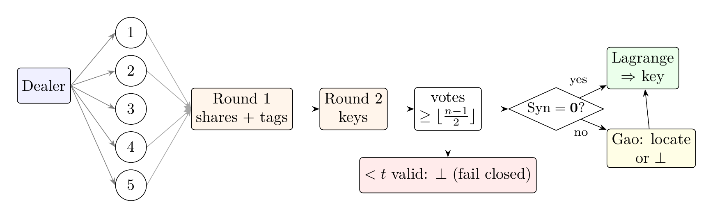
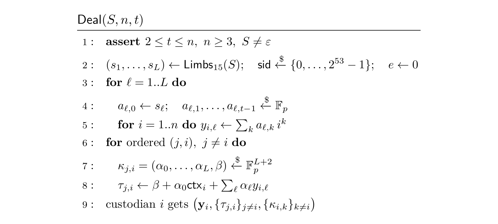
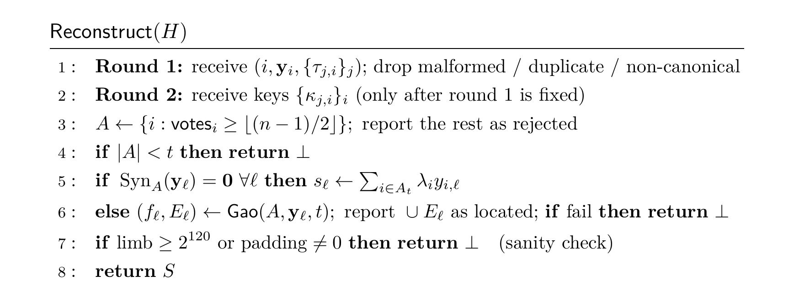
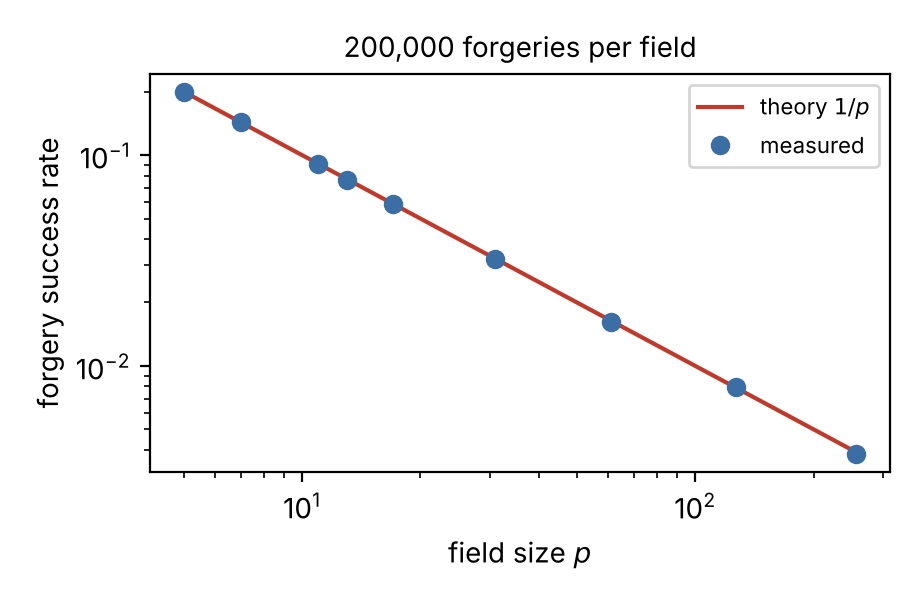
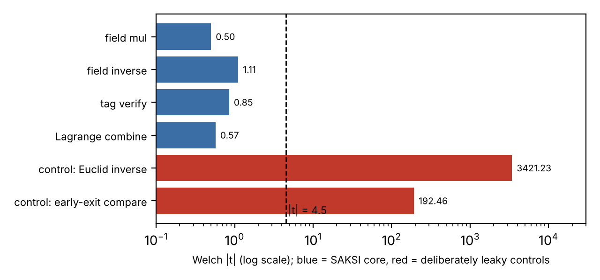

## The problem

A master key that lives in one place is one compromise away from total loss. Splitting it with Shamir secret sharing removes that single point of failure, but plain Shamir **cannot tell a correct share from a wrong one**. Lagrange interpolation always returns *some* key. Tompa and Woll (1988) showed what goes wrong: the last custodian to submit can shift its share so that everyone else reconstructs garbage, while the cheater, who knows what it submitted, recovers the real key.

This matters most for software agents. An AI agent that needs an API credential should never hold it permanently, and the company running the language model should never see it. Splitting the key across custodians helps only if reconstruction **validates** every share, **names** whoever cheated, and **fails closed** instead of using a wrong key.

**SAKSI** (Malay for *witness*) is a cryptographic algorithm that does this. Its only mathematics is number theory and linear algebra, and it uses no pre-existing cipher anywhere.

## The scheme

SAKSI works over the Mersenne prime field \\(\mathbb{F}\_p\\) with \\(p = 2^{127} - 1\\). The key is cut into 120-bit limbs (15 bytes each, so a 32-byte key is 3 limbs), and each limb is shared independently. Any UTF-8 or binary secret works.

**1. Share.** Each limb is encoded with a random polynomial of degree < t, which is a Vandermonde matrix–vector product.

$$
f\_\ell(X) = s\_\ell + a\_{\ell,1}X + \cdots + a\_{\ell,t-1}X^{t-1},\quad a\_{\ell,k} \in \mathbb{F}\_p \text{ uniform},\qquad
\mathbf{y}\_\ell = V\mathbf{a}\_\ell,\quad V = \begin{pmatrix} 1 & 1 & \cdots & 1 \\\\ 1 & 2 & \cdots & 2^{t-1} \\\\ \vdots & \vdots & & \vdots \\\\ 1 & n & \cdots & n^{t-1} \end{pmatrix}
$$

**2. Witness.** Every share i carries one tag per other custodian j. Each tag is computed under a one-time key that only j holds. The tag is an inner product that authenticates all limbs of the share **and** its public context (session id, epoch and index) in a single field element.

$$
\mathsf{ctx}\_i = \mathsf{sid} + 2^{64}e + 2^{96}i,\qquad
\tau\_{j,i} = \beta\_{j,i} + \alpha\_{j,i,0}\\,\mathsf{ctx}\_i + \sum\_{\ell=1}^{L} \alpha\_{j,i,\ell}\\, y\_{i,\ell} \pmod{p}
$$

**3. Two-round reveal.** Shares and tags are fixed first; only then are the keys released. A share is accepted when at least ⌊(n−1)/2⌋ other custodians' keys confirm it. Comparisons are constant time.

$$
\mathrm{votes}\_i = \\#\\{\\, j \neq i : \text{custodian } j\text{'s one-time key confirms } \tau\_{j,i} \\,\\},\qquad
\text{accept } i \iff \mathrm{votes}\_i \ge T = \left\lfloor \tfrac{n-1}{2} \right\rfloor
$$

**4. Syndrome cross-check.** The accepted shares must form a Reed–Solomon codeword. A non-zero parity-check syndrome reveals an inconsistency, for example a dishonest dealer, and Gao decoding pinpoints which share is wrong.

$$
S\_k = \sum\_{i \in A} v\_i\\, x\_i^{k}\\, y\_i \quad (k = 0, \dots, m-t-1),\qquad v\_i = \prod\_{j \in A,\\, j \neq i} (x\_i - x\_j)^{-1},\qquad
\mathbf{S} = \mathbf{0} \iff \exists f,\ \deg f < t,\ f(x\_i) = y\_i\ \forall i \in A
$$

**5. Reconstruct.** The key is rebuilt only from validated shares. With fewer than t valid shares the result is ⊥ and no key is output.

$$
s\_\ell = \sum\_{i \in A'} \lambda\_i\\, y\_{i,\ell},\qquad \lambda\_i = \prod\_{j \in A',\\, j \neq i} \frac{x\_j}{x\_j - x\_i},\qquad |A'| = t
$$

**Proactive refresh.** Adding a fresh sharing of zero moves every share to a new polynomial and a new epoch with new keys. A share stolen before the refresh is rejected after it.

$$
y'\_{i,\ell} = y\_{i,\ell} + z\_\ell(i),\qquad z\_\ell(0) = 0,\ \deg z\_\ell < t,\qquad e \mapsto e + 1
$$

**Keyless fallback.** With no keys at all, Reed–Solomon decoding over n shares corrects up to ⌊(n−t)/2⌋ bad shares. This is a second validation mechanism that works independently of the tags.

**Worked example (toy p = 97, n = 5, t = 3).** f(X) = 42 + 11X + 7X² gives shares (60, 92, 41, 4, 78), and the syndrome is (0, 0). Change share 4 to 9 and the syndrome becomes (80, 29); Gao decoding returns the original f and points at custodian 4. If custodian 3 instead adds 1 to its share, plain Shamir outputs 43 instead of 42, and the cheater knows the true key. SAKSI rejects that share.

## Survives cryptanalysis

The theorems below are proved in full in the paper (PDF linked below). None of them relies on a hardness assumption.

**Theorem 1 (perfect secrecy, including tags).** For every coalition \\(C\\) with \\(|C| \le t-1\\) and every two secrets \\(S, S'\\) of equal length, the joint view of \\(C\\) after Deal (shares, tags, keys and header) has the same distribution under \\(S\\) and \\(S'\\).

**Theorem 2 (witness forgery).** For every adversary, even a computationally unbounded one:

$$
\Pr[\mathsf{Forge}] \le \frac{1}{p} = 2^{-127},
$$

with equality for the best strategy.

**Theorem 3 (robustness and identification).** Let \\(c = |C| \le T = \lfloor (n-1)/2 \rfloor\\) and \\(k = T - c + 1\\), with the two rounds ordered. Every honest share is accepted, and a modified share from a corrupted custodian is accepted with probability at most

$$
\binom{n-c}{k}\\, p^{-k} \\;\le\\; \frac{2^{n}}{p}.
$$

So if at least \\(t\\) honest custodians respond, Reconstruct outputs \\(S\\) and names every modified share, except with probability at most \\(c \cdot 2^n / p\\).

**Theorem 4 (keyless decoding).** With \\(m \ge t\\) shares of which \\(e\\) are wrong, Gao decoding returns the dealt polynomial and exactly the wrong indices when \\(e \le \lfloor (m-t)/2 \rfloor\\), and the syndrome is non-zero whenever \\(1 \le e \le m - t\\).

Because the guarantees are information-theoretic, they hold against an adversary with unlimited computing power, quantum computers included. Nothing rests on factoring, discrete logarithms, lattices or hash functions.

**I attacked my own scheme.** I wrote eight experiments, published in `attacks/`:

- **E1 Exhaustive secrecy.** In toy fields (p, t) = (31, 3), (101, 2) and (13, 4) I enumerated every polynomial. The view of t − 1 colluders, including their tags, has the same distribution for every secret: 0 bits of information.
- **E2 Uniformity.** I ran 100,000 sharings of an all-zero key and applied a χ² test over 256 bins. The p-values were 0.297, 0.941 and 0.885. As a control, a sampler that never picks coefficient 0 (the bug behind RUSTSEC-2024-0398) leaks exactly 0.0056 bits per share. SAKSI's sampler leaks 0.
- **E3 Z3 collusion attack.** With 2 of 3 needed shares, the SMT solver still finds all 31 of 31 candidate secrets for SAKSI (0 bits leaked). Against Mignotte CRT sharing it narrows 1,993 candidates to 14, a leak of 7.15 bits.
- **E4 Forgery rate.** I ran 200,000 forgeries for each of nine primes from 5 to 257. The measured success rate tracks 1/p, with a largest deviation of 0.001.

- **E5 Active attacks at full size** (p = 2¹²⁷ − 1, n = 5, t = 3, 32-byte key):

| Attack | Trials | Plain Shamir returns wrong key | SAKSI returns wrong key | SAKSI names the cheater |
|---|---:|---:|---:|---:|
| bit flip in one share | 1000 | 81.9% | 0.0% | 100.0% |
| random share replacement | 1000 | 100.0% | 0.0% | 100.0% |
| Tompa–Woll: last submitter shifts share | 1000 | 100.0% | 0.0% | 100.0% |
| cross-session substitution | 1000 | 100.0% | 0.0% | 100.0% |
| two colluding cheaters, lying keys | 500 | 100.0% | 0.0% | 100.0% |
| replay share from previous epoch | 500 | 100.0% | 0.0% | 100.0% |
| inconsistent dealer (tags valid) | 500 | 100.0% | 0.0% | 100.0% |

  Plain Shamir misses 18.1% of bit flips only because some errors land in the zero padding of the 2-byte last limb and get truncated away. SAKSI catches those too.

  **Rushing control.** If keys were revealed *before* shares, a cheater could recompute valid tags; this happened in 100% of 500 runs. With SAKSI's two-round order it happened in 0%. In those one-round runs the independent syndrome layer still located the forged share and output the correct key in 100% of cases.

  **Bound tightness.** Three colluders out of five (c = 3 > ⌊(n−1)/2⌋ = 2) who forge a consistent wrong key and vouch for each other succeeded in 100% of 100 runs. This is the expected boundary rather than a hidden flaw: no scheme is robust against a dishonest majority, and with c ≥ t the coalition holds the key anyway.
- **E6 The Rust core.** I ran 150 attacked reconstructions through the compiled binary. It returned the correct key 100% of the time, a wrong key 0%, and named the cheater 100%.
- **E7 Fuzzing.** I fed 2,000 mutated inputs to the Rust binary, covering bad indices, non-canonical numbers, truncated shares, duplicates and missing tags. Result: 0 crashes and 0 wrong keys.
- **E8 Python control.** The Python reference uses variable-time big integers and does leak timing (|t| = 380.2). That is why the deployable core is Rust.

## Distinct from pre-made algorithms

| | Shamir | Feldman / Pedersen VSS | Merkle/hash-committed shares | **SAKSI** |
|---|---|---|---|---|
| Detects a wrong share | no | yes | yes | **yes** |
| Names the cheater | no | yes | yes | **yes, and also localises a bad dealer** |
| Security of validation | none | discrete log (computational) | hash function (computational) | **unconditional, forgery = 1/p** |
| Binds session / epoch / index | no | no | sometimes | **yes, inside every tag** |
| Defends against a rushing last submitter | no | yes | depends | **yes (two-round reveal)** |
| Second, keyless check | no | no | no | **yes (Reed–Solomon syndrome)** |

The ingredients are classical: Shamir 1979, Rabin–Ben-Or 1989 check vectors, Gao 2002 decoding and Herzberg et al. 1995 refresh. The contribution is a specific minimal combination: inner-product witness tags bound to a public context, a ⌊(n−1)/2⌋ vouching rule with a two-round reveal, a syndrome cross-check with a keyless fallback, and a constant-time Mersenne-field implementation. The paper states the threat model and proofs that match the code line by line, and the measurements test every claim.

## Minimises attack surface

- **No cipher, hash, curve or library cryptography in the trust path.** The only external dependency is the operating system's random number generator.
- **Untrusted input is validated.** Values must be canonical field elements, sizes are bounded, index 0 is forbidden, and if two shares claim one index the one with more witness confirmations is kept. Every error path returns ⊥.
- **One-time keys.** Keys are fresh for every epoch, and refresh invalidates old shares.
- **Key lifetime.** In the Rust core, shares, keys, coefficients and the reconstructed key are zeroized as soon as they are used. (In the browser demo the credential briefly exists as a JavaScript string, which cannot be zeroized; it lives for about 1 ms per use.)

**Vulnerability windows mitigated.** Silent corruption, the Tompa–Woll last-submitter attack, rushing during reconstruction, replay and cross-session substitution, stolen old shares (via refresh), an inconsistent dealer, sub-threshold collusion, biased coefficients, timing leaks, and using a wrong key without noticing.

## Number theory and linear algebra

- **Number theory.** The Mersenne prime 2¹²⁷ − 1 gives reduction by shift-and-add because 2¹²⁷ ≡ 1. Inversion is by Fermat, a⁻¹ = aᵖ⁻². The forgery bounds come from counting in the field.
- **Linear algebra.** Shares are a Vandermonde product y = Va and reconstruction uses Lagrange coefficients. The tags are inner products ⟨α, m⟩. The syndrome is a parity-check matrix H = (vᵢxᵢᵏ), and its rank argument proves that the syndrome is zero exactly for valid share sets. Decoding is Reed–Solomon.

$$
2^{127} \equiv 1 \pmod{p} \\;\Longrightarrow\\; x \bmod p = (x \bmod 2^{127}) + \lfloor x / 2^{127} \rfloor \ (\text{then one masked subtraction}),\qquad a^{-1} = a^{\\,p-2}
$$

## Rust implementation and side channels

The core is written in **Rust** and also compiles to WebAssembly. Every operation on secret data is branch-free. Multiplication uses four 64×64-bit products followed by a masked reduction. Inversion uses a fixed 127-step ladder that always multiplies and then selects the result with a mask. Equality checks are constant time, and `black_box` stops the compiler from turning masks back into branches.

**Timing study.** I followed the dudect method: inputs are prepared before timing, classes are interleaved at random, 5% of outliers are cropped, and a Welch t-test is applied (a leak means |t| > 4.5). My first run was invalid because it generated the random inputs inside the timed region, so I redid it.

| Operation (Rust core) | Samples | \|t\| | Verdict |
|---|---:|---:|---|
| field multiply (fixed 0 vs random) | 1,000,000 | 0.50 | no leak detected |
| field inverse (fixed 1 vs random) | 250,000 | 1.11 | no leak detected |
| tag verify (valid vs forged tag) | 1,000,000 | 0.85 | no leak detected |
| Lagrange combine (zero key vs random key) | 1,000,000 | 0.57 | no leak detected |
| *control:* leaky Euclid inverse | 250,000 | 3421.23 | LEAK |
| *control:* early-exit compare | 1,000,000 | 192.46 | LEAK |

Both deliberately leaky controls are flagged, which shows the test can detect a leak when one exists.

**Speed** (release build): a field multiply takes 9.0 ns and an inverse 2.43 µs. Dealing a 32-byte key 3-of-5 takes 40.8 µs, validated reconstruction 45.2 µs, and keyless decoding with one bad share 62.6 µs.

**Tests.** The Rust core has 4 field unit and property tests (256 random cases each) and 10 scheme integration tests. The Python reference has 18 tests. A 30-round Python↔Rust cross-check deals in one language and reconstructs in the other, with byte-identical results.

## Applied environment: the Kunci Agent

The WebAssembly build runs in a browser app. A real API credential (for a mock ledger service of a fictional Malaysian SME) is dealt 3-of-5 across five custodians, all simulated in the browser for the demo: this device, a passkey vault, server escrow and two colleagues. An LLM agent (Gemini 3 Flash via function calling, with Groq as a fallback) plans the user's task. When the agent needs the credential, it calls a tool that runs SAKSI's two-round validated reconstruction. The tool shows which custodians were accepted, rejected or located, uses the key for exactly one request, and then wipes it. **The model only ever receives the tool's result; no share, tag, key or credential reaches the LLM provider.** A *tamper* switch on each custodian lets you rerun the attacks live.

## Limitations

- **Trusted dealer for each epoch.** An inconsistent dealer is detected, but a dealer that leaks the key is not prevented.
- **Key material grows as O(n²L).** That is 432 bytes per custodian for n = 5 and a 32-byte key. This is fine for key custody but not for bulk data.
- **Honest majority required.** Robustness needs c ≤ ⌊(n−1)/2⌋. E5 shows that the bound is tight.
- **Channel requirements.** The combiner must enforce the two-round order and know which custodian sent each message.
- **Key in memory.** The key exists in RAM at the moment it is used, so malware on that machine could read it.
- **Measurement limits.** Timing was measured on a cloud VM. The browser's WebAssembly JIT gives no constant-time guarantee, and power or electromagnetic side channels are out of scope.
- **Centralised refresh.** Refresh is done by a single refresher; a distributed refresh is future work.
- **Public length.** The secret's length is visible in the public header.

## Links

- 📄 Paper (13 pages, LaTeX source and PDF): https://github.com/ShermaineYap/saksi/blob/main/paper/saksi.pdf
- 💻 Code (Rust core, Python reference, attack harness): https://github.com/ShermaineYap/saksi
- 🌐 Live demo: https://saksi-gamma.vercel.app
- 🎬 Video: https://youtu.be/GXIt0Ia1Kog

---

## Inspiration
I kept seeing "split the key with Shamir" given as the answer to key custody. Then I read about the Tompa–Woll attack, and about real implementations broken by biased coefficients. A secret-sharing scheme that cannot tell a good share from a bad one felt like half a solution, especially for AI agents that need credentials the model provider must never see.

## What it does
SAKSI splits a master key into n shares, any t of which rebuild it. It checks every share before using it, names any custodian who cheated, and refuses to output a key it cannot validate. The Kunci Agent demo shows an LLM agent using a credential this way without the key ever reaching the model.

## How I built it
I wrote a Python reference to serve as the specification and test oracle, then a constant-time Rust core, cross-checked byte-for-byte against it. I compiled the core to WebAssembly for the browser demo. Next came an attack harness of eight experiments (including Z3 and fuzzing) and a dudect timing study. Last, I wrote the LaTeX paper, whose numbers are generated straight from the result files.

## Challenges I ran into
My first timing study flagged everything as leaking. The cause was that it timed the random-number generator, not the arithmetic. I had to learn the dudect method properly and redo it. Getting the robustness counting exactly right (who vouches for whom, and what happens at c = 3 of 5) also took several iterations, and a test that deliberately breaks the bound.

## Accomplishments that I'm proud of
Every claim in the write-up is either proved or measured, and the results files are in the repo. The constant-time study includes positive controls, so it is clear the test has teeth. I also attacked my own scheme and published the cases where it is *supposed* to fail.

## What I learned
Information-theoretic tools such as one-time MACs, Reed–Solomon codes and counting arguments give guarantees that do not depend on anyone's computer being too slow. And "constant time" is something you measure, not something you assume.

## What's next
Dealer-free key generation, so that no single party ever sees the key. A distributed proactive refresh. Shorter tags in the style of Cevallos et al. to cut the O(n²) key material. And a native custodian app that keeps shares in hardware-backed storage.
